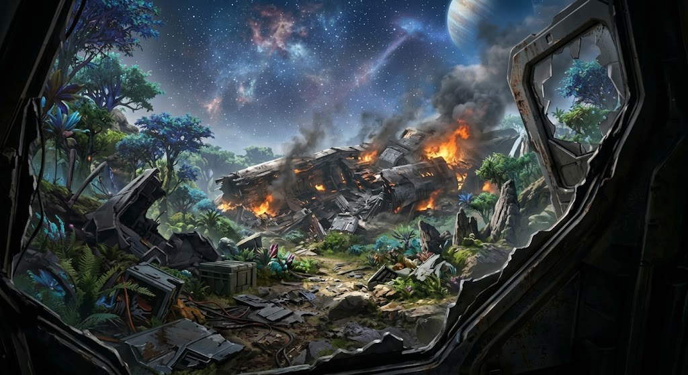
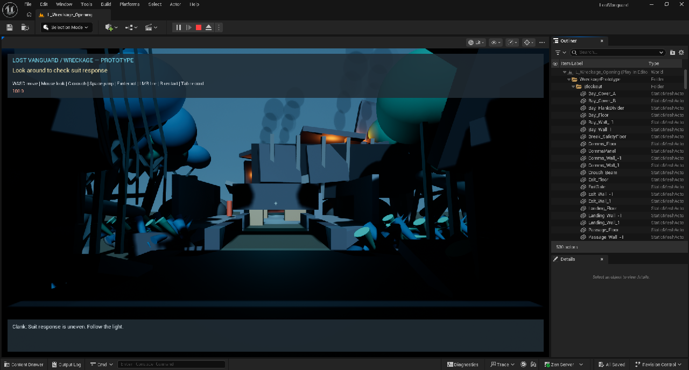

# Lost Vanguard

Original military science-fiction game and animation project. Working title. Early prototype stage. October 7, 2026.

## The pitch

A soldier built by the enemy wakes inside his destroyed ship, days after an attack he cannot remember. With his damaged robot companion, he fights through the wreck and investigates a war whose true cause humanity does not understand.

Lost Vanguard combines military action, alien ruins, and a mystery uncovered through missions. The aim is a distinct world with the scale and atmosphere of military science fiction, its own cast, and its own history.

## The world and characters

Orison is a planet containing technology left by an extinct civilization. Humanity is fighting an alien species while a powerful escaped AI threatens both sides.

- Evan: a Praetorian supersoldier created through forced enemy experiments and later rescued by humans. A restrained leader whose presence and instincts help others act.
- Clank: his small robot companion and best friend. Survived inside Evan's shielded suit, but EMP damage erased most of his memories. Guides recovery and accesses fresh evidence.
- Meridian: an alien-created AI whose drive to improve itself damaged its identity. It seeks ancient technology to stabilize what it has become.
- Major Lena Cross and Commander Dorian Vale: two separate supporting officers. Their names are selected; their exact roles and personalities are still being developed.

## Visual direction

Opening reference supplied by the project creator: a dark torn hull framing a smoldering ship section in lush alien forest. This shows the intended atmosphere, not current gameplay or finished game art. Final character designs, sky details, and precise layout remain open.

## What the player does first

Free Evan from debris, complete Clank's recovery checks, obtain a weapon, fight the wreck searchers, recover a search record, and restore communications to find a route toward human forces.

The aim is to make the tutorial part of the story: Evan is already trained, but needs to establish that his body and suit still function.

## What exists now

Actual Unreal editor play screenshot. Simple shapes represent the ship, forest, and other scenery while the route and gameplay are developed.

A saved first-level prototype includes movement, debris interaction, recovery objectives, a weapon, two placeholder enemies, damage and restart, a record interaction, communications, and a gated exit. The baseline prototype passed 19 recorded automated editor play checks. An additional opening map explores the supplied forest-and-wreck reference. Its full route verification was still pending in the visual build report at the time of this brief.

The art is rough. Clank uses subtitles, and enemy behavior is basic. Physical keyboard/mouse feel, normal-health combat balance, performance, finished voices, cinematics, and a packaged game still need work.

## Where it is going

The proposed opening arc moves from the wreck to a human rally point, an enemy relay, a research archive, and a departure record. Each mission supports the war effort while uncovering why Evan's ship was attacked. This is a proposed story direction, not five completed levels.

The immediate goal is one convincing playable opening: a clear route, satisfying movement and combat, readable clues, and a stronger wreck-and-forest environment. Then replace placeholders with a small reusable asset set and develop voices and animation.

AI assists with planning, writing, coding, and supported editor tasks. Creative decisions remain with the project creator. Unreal is the game engine; Blender supports asset preparation. Meshy assets and ElevenLabs voices are intended parts of the workflow, with transfers and voice production still to be verified.

## Useful feedback from a friend

Does the opening make you want to learn what happened? Which character or part of the world interests you most? Does the wreck-and-forest atmosphere fit the premise?
